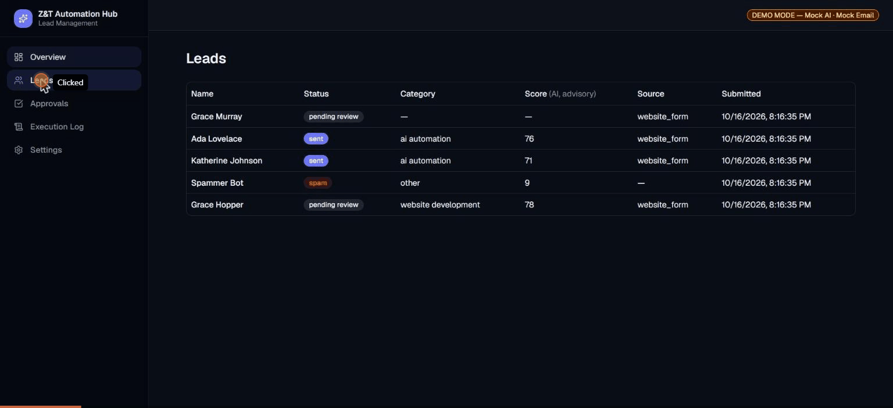
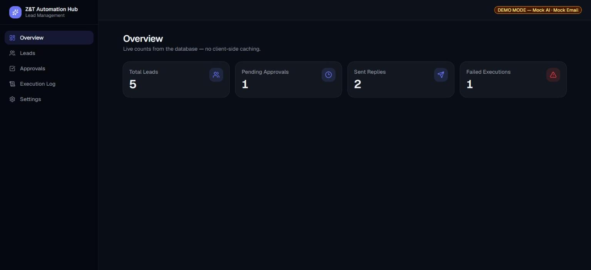
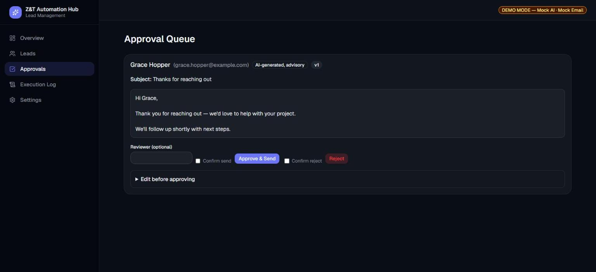
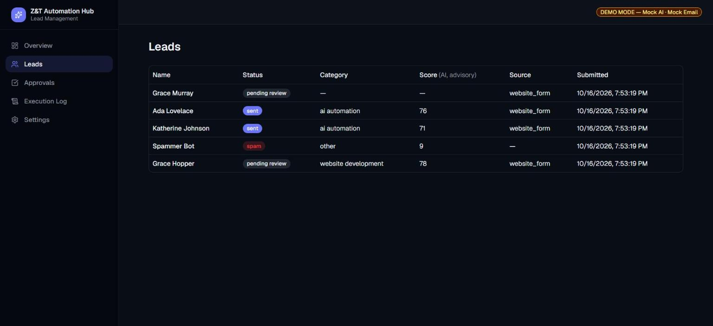
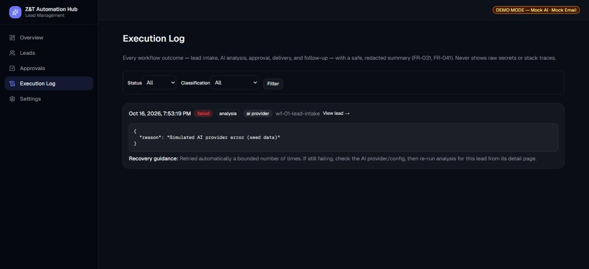

# Z&T AI Automation Hub — Complete Project Documentation

**Project type**: Portfolio-grade AI workflow automation system
**Built for**: Demonstrating real, verifiable n8n + AI automation competency to prospective
Upwork/Fiverr clients
**Status**: All four user stories complete, implemented, tested, and documented
**Last updated**: 2026-10-16

This is the single consolidated reference for the project — what it does, how it's built, how
to run it, and what it honestly does and doesn't do yet. For deeper detail on any one topic, this
document links out to the focused doc that owns it (`docs/architecture.md`,
`docs/security.md`, etc.) rather than duplicating it.

---

## 1. What this project is

A business receives inquiries through a public web form. Each inquiry needs to be captured,
understood, replied to, and followed up on — without spamming, without fabricating promises the
business can't keep, and without ever sending anything a human didn't explicitly approve.

This project builds that pipeline end-to-end:

```
Inbound inquiry → validate & store → AI qualifies the lead → draft a reply
    → human reviews, edits, approves, or rejects → approved reply sent
    → consent-aware follow-up scheduled → every outcome logged and recoverable
```

It is **not** a toy — it implements real validation, deduplication, a strict AI-output schema,
an auditable human-approval gate, idempotent sending, structured failure classification, and a
documented recovery runbook. It **is** explicitly a demo/portfolio build: it runs entirely on
mock AI and mock email by default, with zero paid credentials required, and every limitation
below is stated plainly rather than hidden.

## 2. The problem this solves

Small businesses that start running ads or publishing a contact form quickly drown in inbound
inquiries that vary wildly in quality — tire-kickers, spam, and genuine high-intent prospects all
land in the same inbox. Two failure modes are common:

1. **Slow, inconsistent manual triage** — a real lead sits unanswered for a day because nobody
   got to it, or gets a generic reply that doesn't address what they actually asked for.
2. **Unsupervised automation overcorrecting** — a "smart" auto-responder sends a reply (or worse,
   a quote/commitment) based on an AI's first guess, with no human in the loop, and the business
   only finds out something went wrong when the prospect complains.

This project is built around the idea that AI should **qualify and draft**, and a human should
**always be the one who sends** — the system is an assistant to a reviewer, not a replacement for
one.

## 3. Key features

### 3.1 Capture and qualify a lead (User Story 1)
A public n8n webhook receives the inquiry. It's validated (required fields, email format, length
caps), deduplicated (idempotency key, or a normalized-email + message-fingerprint fallback window
so retried/duplicate submissions never create a second lead), and persisted. An AI adapter then
produces a structured qualification: category, intent, urgency, budget band, a 0–100 lead score,
score factors, missing information, and a recommended next action — all validated against a
strict schema before it's ever shown to a reviewer. A malformed or failed AI response never
fabricates an answer; the lead is stored and routed to manual review instead.

### 3.2 Review, approve, and send (User Story 2)
Every AI-drafted reply is clearly labeled **AI-generated, advisory** and shown to a reviewer in
the Approval Queue. The reviewer can approve, edit-then-approve, or reject — editing always
creates a new, separately-approvable version rather than silently mutating what's on screen.
Nothing is ever sent without an explicit, confirmed approval action, and approving the same draft
twice (a double-click, a retried request) is provably safe: the second attempt reports
`already_sent` and never creates a second delivery.

### 3.3 Consent-aware follow-ups (User Story 3)
A lead that explicitly opted in to follow-up, and hasn't replied, gets a bounded number of
follow-up drafts (each requiring its own approval, exactly like an initial reply) after a
configurable delay. A reply, a closed lead, or an opt-out recorded at any point cancels any
scheduled follow-up immediately — there's no path for the system to keep emailing someone who
said stop.

### 3.4 Investigate and recover from failures (User Story 4)
Every workflow outcome — success or failure — is logged with a safe, redacted summary. Failures
are classified into one of six categories (validation, AI provider, persistence, approval, email
delivery, unexpected), each with documented recovery guidance an operator can act on without
reading source code. Validation failures are never auto-retried; transient provider/delivery
failures are retried with bounded backoff. Nothing in a logged failure ever contains a raw secret,
token, or stack trace — see `docs/runbook.md` for the full per-classification guide.

## 4. Demo

A short animated walkthrough — lead review → AI analysis (advisory-labeled) → approve & send →
Execution Log — recorded directly from the running dashboard with fictional seed data:



Every click in it is real, not staged: the lead shown, its AI analysis, and the resulting
`delivery` event in the Execution Log are the actual output of the live stack. A narrated version
with voiceover is also available: **[`docs/demo/zt-automation-hub-demo-narrated.mp4`](./demo/zt-automation-hub-demo-narrated.mp4)**
(script: [`docs/demo/narration-script.md`](./demo/narration-script.md)) — produced entirely
offline (local text-to-speech, `ffmpeg`), with no footage uploaded to any third party. For a
hands-on version you can run (and record) yourself, see `docs/manual-testing-guide.md`.

## 5. Screenshots

All screenshots use fictional seed data (`database/seed/leads.ts`) — no real inquiry data ever
appears here, consistent with the project's data-honesty principle.

**Overview** — live counts, zero client-side caching:


**Approval Queue** — AI-generated draft, advisory labeling, confirm-gated actions:


**Leads** — every submission with its status, AI category, and advisory score:


**Execution Log** — classified failures with redacted detail and recovery guidance:


## 6. System architecture

```text
                         ┌─────────────────────────────┐
  public web form ──────▶│  n8n (orchestrator)          │
                         │  public webhook · scheduling │
                         │  retries · error routing     │
                         └──────────────┬──────────────┘
                                        │ internal API, shared-secret header
                                        ▼
                         ┌─────────────────────────────┐
  reviewer (browser) ───▶│  Next.js dashboard            │
                         │  UI + /api/internal/* routes │
                         │  validation · AI & email      │
                         │  adapters · business rules     │
                         └──────────────┬──────────────┘
                                        │ parameterized SQL (Drizzle)
                                        ▼
                         ┌─────────────────────────────┐
                         │  PostgreSQL                  │
                         └─────────────────────────────┘
```

**The one deliberate architectural decision**: n8n stays a thin orchestrator (public webhook,
scheduling, retries, error routing); every validation rule, AI/email adapter call, and business
rule lives in testable TypeScript behind a private internal API that only n8n and the dashboard
itself can reach. This keeps business logic unit-testable without spinning up n8n, while still
showcasing four real, exported n8n workflows doing real orchestration work — not a demo that
quietly reimplements everything in application code and leaves n8n as decoration.

Full detail, including the alternatives considered and why: **`docs/architecture.md`**.

### 5.1 The four n8n workflows

| Workflow | Trigger | Job |
|---|---|---|
| WF-01 — Lead Intake | Public webhook | Validate, dedup, persist, trigger AI analysis |
| WF-02 — Approval & Email | Internal webhook (dashboard-only) | Re-validate approval state atomically, send via the email adapter exactly once |
| WF-03 — Follow-up Scheduler | Schedule trigger | Find due, eligible follow-ups and route them through the same approval path |
| WF-04 — Error Handler | n8n's native Error Trigger | Catch anything the other three didn't already classify themselves; log it redacted |

Full node-by-node detail: **`docs/workflow-catalog.md`**.

## 7. Technology stack

| Layer | Choice | Why |
|---|---|---|
| Orchestration | n8n 2.43.5 (self-hosted, Docker) | The named automation platform this project showcases |
| Dashboard + internal API | Next.js 16 (App Router), TypeScript | Server Components for always-fresh reviewer data; Route Handlers keep credentials server-side only |
| Validation | Zod 4 | Strict schema validation at both the intake boundary and the AI-output boundary |
| Database | PostgreSQL 18, via Drizzle ORM | Parameterized queries by construction; migrations under `database/migrations` |
| Styling | Tailwind CSS v4 + shadcn/ui | Accessible primitives (labels, focus states, keyboard nav) out of the box |
| Testing | Vitest (unit + integration) | One dependency covers both business-rule unit tests and real-stack integration tests |
| AI adapter | Pluggable interface, deterministic mock by default | Same schema-validation boundary for mock and real providers — no "the real path skips a check" class of bug |
| Email adapter | Pluggable interface, mock by default | Structurally impossible to send a real email while `MOCK_EMAIL=true` |

Full version-pin rationale: `specs/001-lead-management-hub/research.md`.

## 8. Data model (summary)

Five entities, each mapping 1:1 to a real-world concept — no credentials or secrets stored in any
of them:

- **Lead** — the normalized inquiry, with idempotency key and dedup fingerprint
- **LeadAnalysis** — the AI's structured qualification (1:1 with Lead)
- **ReplyDraft** — versioned; at most one version per lead can ever reach `sent`
- **WorkflowEvent** — one row per workflow outcome, success or failure, classified and redacted
- **FollowUp** — one row per follow-up attempt, capped by a configured maximum

Full schema, constraints, and state-transition diagrams: `specs/001-lead-management-hub/data-model.md`.

## 9. Security & compliance highlights

- Every service binds to `127.0.0.1` only — nothing in this stack is reachable from the network
  by default.
- The internal API requires a shared-secret header on every request, compared in constant time
  (not `===`) to avoid timing side-channels.
- The AI adapter receives only the minimum fields needed to produce an analysis — never the
  lead's email, company, or internal ID.
- All database access goes through Drizzle's parameterized queries; there is no raw
  string-concatenated SQL in application code.
- **Known, documented limitation**: the reviewer/approval surface has no authentication of its
  own in this version — it relies entirely on being local-only. This is stated explicitly, not
  hidden, per the project's honesty principle, and is the first thing to harden before any
  public exposure.

Full detail: **`docs/security.md`**.

## 10. Testing & quality assurance

| Check | Result |
|---|---|
| Unit tests (`pnpm test`) | 71 tests, 7 files — validation, dedup, approval state machine, follow-up eligibility, error classification, both adapters |
| Integration tests (`pnpm test:integration`) | 16 tests, 4 files — real HTTP calls against the live stack: full intake→send flow, duplicate-delivery safety, follow-up eligibility, failure classification |
| Type checking | Clean across all 4 workspace packages |
| Linting | Clean, root + all workspace packages |

These numbers are re-run, not carried forward from memory — see **`docs/testing.md`** for the
exact commands and what each suite specifically covers, and **`docs/manual-testing-guide.md`**
for a hands-on, click-through functional walkthrough you can run (and record) yourself.

## 11. Project scale

- 46 functional requirements, 9 measurable success criteria (`specs/001-lead-management-hub/spec.md`)
- ~3,600 lines of first-party TypeScript across the dashboard app and shared packages
- 4 real, exported, version-controlled n8n workflows
- 2 database migrations, 5 entity tables
- 11 test files, 87 total test cases
- 7 phases of spec-driven implementation, each with its own Prompt History Record under
  `history/prompts/001-lead-management-hub/`

## 12. Known limitations (stated honestly, not omitted)

- The approval surface is local/demo-only — no reviewer authentication yet (see §8).
- No inbound-email-reply detection — recording a reply or opt-out is a manual operator action.
- Retention is indefinite by default; deletion is a documented manual SQL procedure, not an
  automated policy (required before any real client data is processed — see `docs/security.md`).
- Single operator role; not multi-tenant.
- No browser-based UI/visual-regression test suite — UI correctness is verified manually each
  phase (see `docs/testing.md` for the reasoning).

## 13. Setup

Full, verified steps (including the genuinely manual n8n first-run setup): **`docs/setup-local.md`**.
Short version:

```bash
cp .env.example .env
docker compose up -d
# complete n8n's one-time owner setup + import/activate the 4 workflows — docs/setup-local.md §4
pnpm db:migrate
pnpm db:seed
```

No paid credentials are required for any of the above.

## 14. Document map

| Need to know... | Read |
|---|---|
| How the system is put together, and why | `docs/architecture.md` |
| What each n8n workflow actually does, node by node | `docs/workflow-catalog.md` |
| How to actually get this running | `docs/setup-local.md` |
| What's tested and how to run it | `docs/testing.md` |
| A hands-on, click-through functional test you can record | `docs/manual-testing-guide.md` |
| Network, secrets, data-minimization, deletion | `docs/security.md` |
| What to do when the Execution Log shows a failure | `docs/runbook.md` |
| A scripted narration for a short demo video | `docs/portfolio-demo-script.md` |
| The actual recorded demo | `docs/demo/zt-automation-hub-demo.gif` |
| Full original specification | `SPEC.md`, `specs/001-lead-management-hub/spec.md` |
